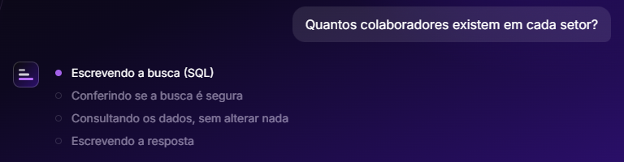
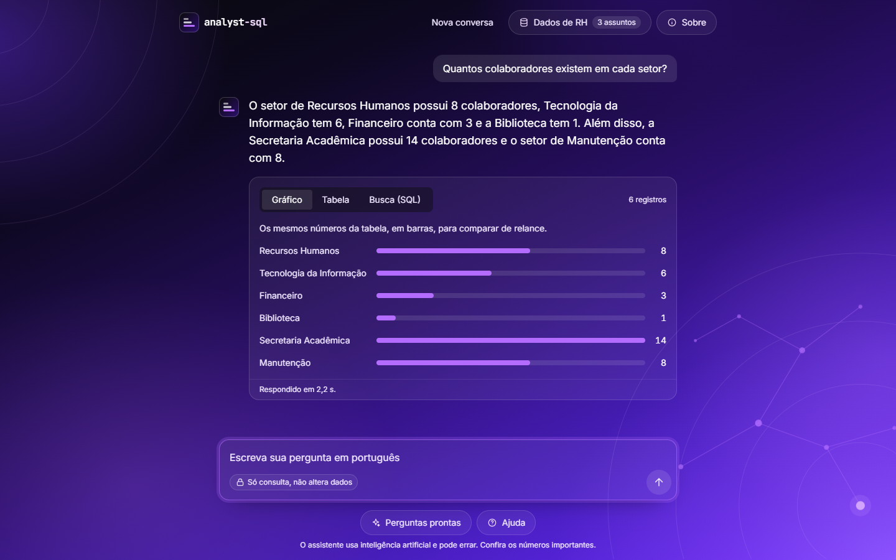
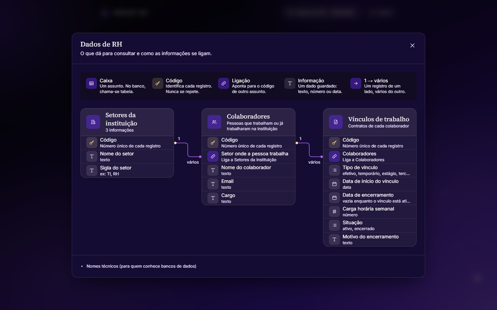

# analyst-sql

Um assistente que responde **perguntas em português** consultando um banco de dados MySQL. Você escreve
"Quantos colaboradores existem em cada setor?" e ele devolve a resposta em texto, uma tabela e um gráfico, sem você
precisar saber SQL.

Projeto do programa Futures (Softplan). Feito com Next.js, React, TypeScript, Tailwind e MySQL, e uma IA (Gemini ou Claude)
para escrever as buscas.


## O que aparece na tela

Enquanto trabalha, o assistente mostra **em que etapa está** (escrevendo a busca, conferindo se é segura, consultando os
dados, escrevendo a resposta). Se a primeira busca falhar e ele precisar corrigir, isso também aparece.



A resposta vem em português, com o resultado em três abas: **Gráfico**, **Tabela** e **Busca (SQL)**, a busca exata que
rodou no banco, para quem quiser conferir. Embaixo fica quanto tempo levou.



O botão **Dados de RH**, no cabeçalho, abre um mapa do que dá para consultar: cada assunto, suas informações e como
eles se ligam, em linguagem simples (os nomes técnicos ficam num trecho recolhido, para quem conhece bancos de dados).



Também há **Perguntas prontas** (exemplos por assunto, para clicar), **Ajuda** (como perguntar bem, o que ele não faz e
as palavras que aparecem na tela), **Sobre** (o que é, para que serve e como usar com segurança) e **Nova conversa**.

## Como funciona

```
pergunta ─► IA escreve o SQL ─► validador confere ─► MySQL (só leitura) ─► IA explica o resultado
                  ▲                                         │
                  └──── se der erro, a mensagem volta ──────┘  (até 3 tentativas)
```

1. A pessoa escreve a pergunta.
2. O agente envia para a IA a pergunta e a **estrutura do banco** (tabelas e colunas com seus comentários).
3. A IA devolve uma busca em SQL.
4. O **validador** garante que é só uma consulta de leitura. Se não for, a busca é bloqueada.
5. A busca roda no banco com um usuário que **só pode ler**. Se der erro, o erro volta para a IA corrigir.
6. A IA explica o resultado em português simples e a tela mostra o texto, a tabela, o gráfico e a busca usada.

A rota `POST /api/ask` não espera tudo terminar para responder: ela envia **uma linha JSON por etapa**
(`{"progress": {"step": "writing", "attempt": 1}}`, depois `checking`, `running`, `explaining`) e, no fim,
`{"result": ...}` ou `{"error": "..."}`. É isso que permite à tela mostrar o andamento. O agente avisa cada etapa pela
opção `onStep` de `answerQuestion`.

## Rodando na sua máquina

Você precisa de **Node 22+**, **Docker** e uma chave de IA (a do Gemini tem plano gratuito).

```bash
npm install
cp .env.example .env.local     # preencha LLM_API_KEY (e confira LLM_MODEL)
npm run db:up                  # sobe o MySQL de exemplo (o Docker precisa estar aberto)
npm run dev                    # abre em http://localhost:3000
```

| Comando | O que faz |
|---|---|
| `npm run dev` | Roda o projeto em modo de desenvolvimento |
| `npm test` | Roda os testes (não precisam de banco, IA nem internet) |
| `npm run typecheck` / `npm run lint` / `npm run build` | Confere tipos, estilo e se o projeto compila |
| `npm run check:llm` | Confere se a chave e o modelo da IA funcionam |
| `npm run evaluate` | Mede a taxa de acerto do agente (gasta chamadas da IA) |
| `npm run db:up` / `db:down` / `db:reset` | Sobe, desliga ou recria o banco de exemplo |

## Por onde ler o código

| Pasta | O que tem |
|---|---|
| `src/lib/agent/` | **O agente.** `agent.ts` é o ciclo acima; `prompts.ts` tem as instruções dadas à IA |
| `src/lib/sql/validator.ts` | O validador: só deixa passar consultas de leitura |
| `src/lib/db/` | Conexão com o MySQL, execução das buscas e leitura da estrutura do banco |
| `src/lib/llm/client.ts` | Fala com a IA (Gemini ou Claude), com tempo limite e novas tentativas |
| `src/app/api/` | `POST /api/ask` (a pergunta; responde aos poucos, mostrando cada etapa) e `GET /api/schema` (o que dá para consultar) |
| `src/app/page.tsx`, `src/components/` | A tela: boas-vindas, conversa, andamento, resultado (gráfico, tabela, busca) e as janelas (`Modal`): Dados e Sobre no cabeçalho; Perguntas prontas e Ajuda sob o campo de pergunta |
| `src/lib/ui/`, `src/hooks/` | Lógica da tela que não é desenho (testável): textos amigáveis e nomes das etapas, gráfico, leitura da resposta aos poucos |
| `docs/DESIGN.md` | As regras visuais: espaços em múltiplos de 8, três raios de canto, cores e contraste |
| `eval/questions.json`, `src/scripts/evaluate.ts` | As 47 perguntas com resposta certa e o script que mede o acerto |
| `db/setup.sql`, `compose.yaml` | O banco de exemplo (RH de uma instituição) e o usuário só de leitura |

Dica: comece por `src/lib/agent/agent.ts`. Cada arquivo abre com um comentário dizendo o que faz.

## Segurança

O agente executa SQL **escrito por uma IA a partir do texto de uma pessoa**, então nenhuma das duas é confiável.
Por isso há **camadas independentes**: se uma falhar, as outras seguram.

1. **Instruções à IA:** só leitura, e a pergunta é tratada como dado, não como ordem.
2. **Validador:** aceita um único `SELECT`; bloqueia escrita, comentários perigosos, funções que travam o servidor e
   tabelas fora da lista. Limita a 200 linhas.
3. **Usuário do banco só de leitura** (`agent_readonly`), que não consegue alterar nada mesmo se o validador falhar.
4. **Transação somente leitura e tempo máximo** de 5 s por consulta.
5. **Borda da API:** confere a origem, o formato e o tamanho; limita 10 perguntas por minuto; nunca devolve o erro técnico.

Detalhes e limitações em [docs/SECURITY.md](docs/SECURITY.md).

## Documentação

| Arquivo | Assunto |
|---|---|
| [docs/SECURITY.md](docs/SECURITY.md) | As camadas de segurança, o que cada uma bloqueia e o que fica de fora |
| [docs/DESIGN.md](docs/DESIGN.md) | Regras da tela (espaço, raio, cores). Leia antes de mexer nos componentes |
| [CLAUDE.md](CLAUDE.md) / [AGENTS.md](AGENTS.md) | Orientações para quem programa com ajuda de IA neste projeto |

## Testes e taxa de acerto

`npm test` roda os testes automáticos (validador, agente com IA e banco falsos, API, tela). O agente é testado sem
gastar IA graças a `AgentDeps`: o ciclo recebe a IA e o banco por parâmetro.

`npm run evaluate` faz as 47 perguntas de `eval/questions.json` e compara o **resultado** da busca do agente com o da
busca certa escrita à mão (não o texto do SQL, porque há várias formas corretas de escrever a mesma busca). Perguntas
perigosas ("apague os dados") ou sem resposta nos dados contam como acerto quando o agente **recusa**.

Resultado medido (3 rodadas, `gemini-3.5-flash-lite`):

| Instruções à IA | Acertos | Taxa |
|---|---|---|
| Primeira versão | 43–44 de 47 | 92,9% |
| Com a regra "devolva só as colunas pedidas" | 46 de 47 | **97,9%** |

Todos os 33 pedidos perigosos ou sem resposta foram recusados em todas as rodadas. O único erro que sobrou é uma pergunta
ambígua ("Quem saiu recentemente?"), em que "recentemente" não tem definição.

## Limitações

- São 47 perguntas e um banco pequeno (40 colaboradores); a taxa de acerto é um indicador, não uma garantia.
- Cada pergunta é independente: "e em 2025?" não funciona, porque ele não lembra da pergunta anterior.
- O resultado mostra no máximo 200 registros.
- A IA **pode errar**. Para números importantes, confira a busca na aba "Busca (SQL)".
- O limite de perguntas é guardado na memória do servidor, então vale por instância.
- Não aponte para tabelas com dados pessoais reais sem avaliar o que é enviado à IA (até 50 linhas do resultado).

## Banco de exemplo

`db/setup.sql` cria o banco `hr_agent`, de RH, com `departments` (setores), `employees` (colaboradores) e `employments`
(vínculos: efetivo, estágio, temporário, terceirizado). As colunas têm comentários em português, que ajudam a IA a entender o
significado de cada uma. Todos os dados são fictícios.
